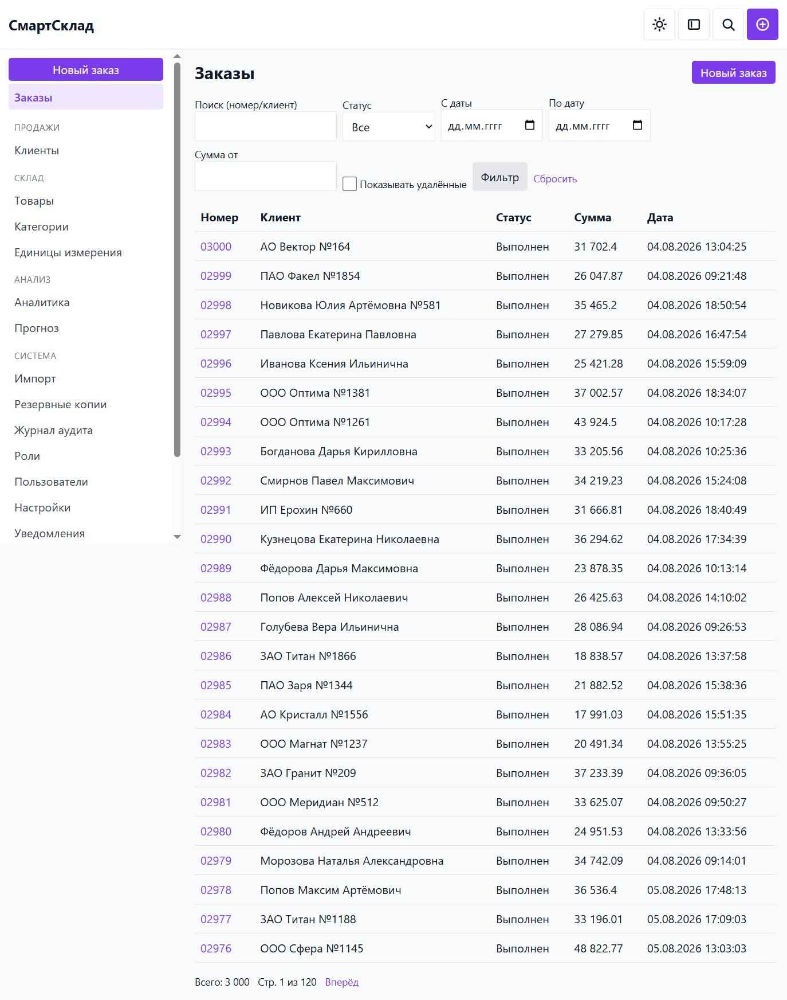
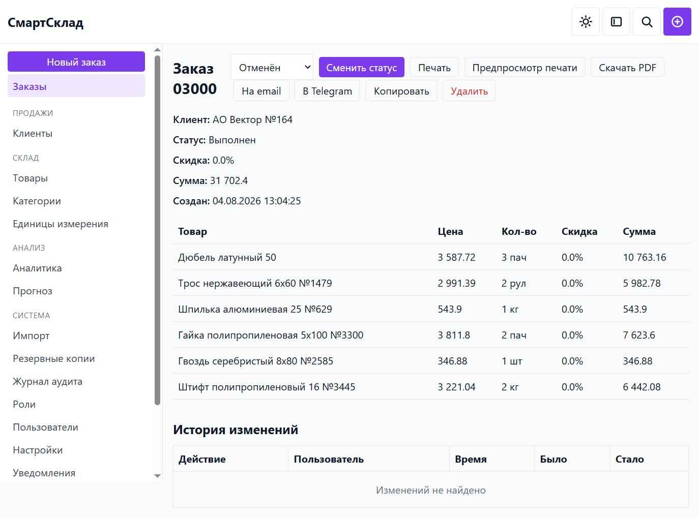
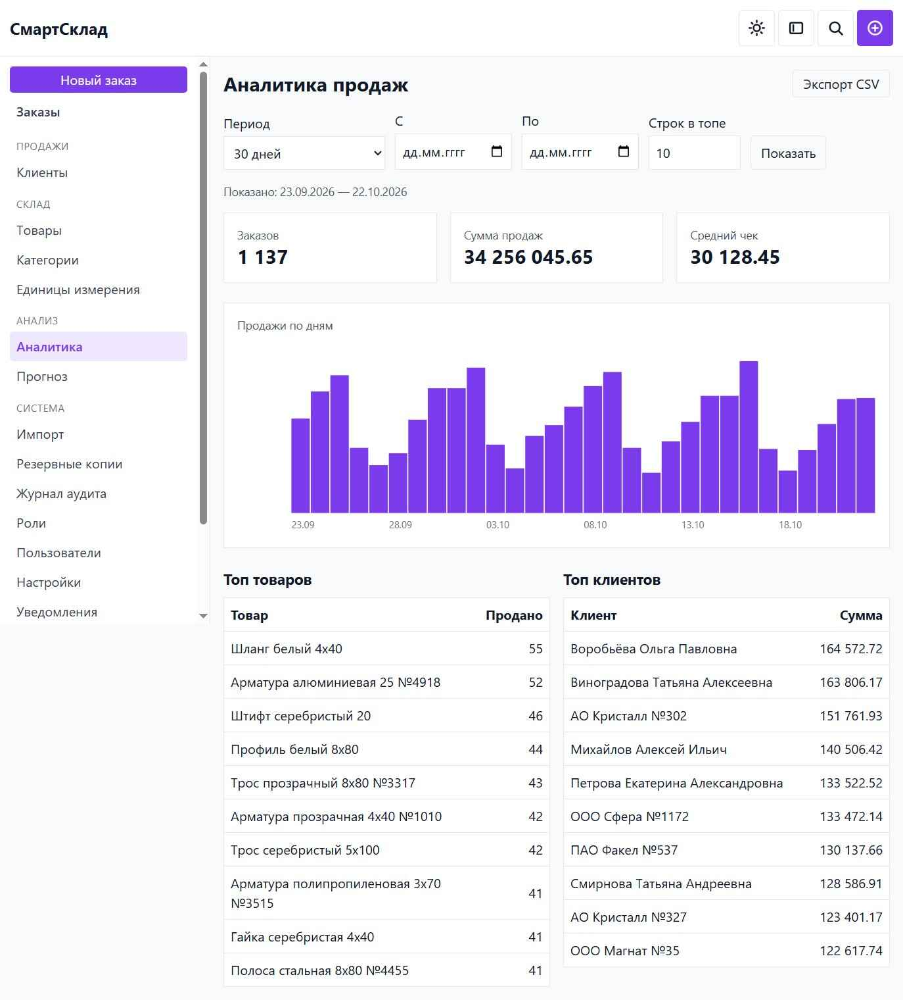
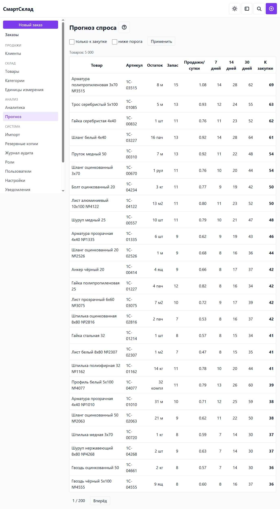

English | [Русский](README.ru.md)

# SmartSklad


A web app for a small shop: customers, products, orders, stock, document printing,
notifications, sales analytics and demand forecasting.
**Stack:** FastAPI, synchronous SQLAlchemy, PostgreSQL, Jinja2, ReportLab, Tailwind.

The layout ships as prebuilt CSS, so no bundler runs in production - `app/static/app.css`
is committed and served as is. Node is needed only to rebuild it after a style change.

## Features

- **Orders** - create and edit, customer and product lookup by typing, four statuses,
  stock write-off on "Done" and return on rollback, per-line and per-order discounts,
  copy of an order, audit trail on the card
- **Products** - card with description, categories, units of measure, price history,
  stock tracking, per-product minimum stock
- **Customers** - card, search by name, phone or INN, personal discount, order
  statistics
- **Stock** - balances, scheduled and manual backups (`pg_dump`), restore with a
  countdown
- **1C import** - JSON export of products, customers and orders; matching against
  already existing records by id or name, no duplicates on a repeated run
- **Printing** - one order document for print preview, PDF, email and Telegram;
  print straight from the order page
- **Notifications** - email to the customer and a Telegram message, both with a PDF
  attachment
- **Analytics** - sales by period, chart, top products and customers, CSV export
- **Demand forecast** - linear regression over 90 days of sales, a "to purchase"
  recommendation and a below-threshold filter
- **Roles and permissions** - four system roles (seller, warehouseman, manager,
  admin), grants managed from the UI, login rate limiting
- **Audit log** - who changed what, when, from which address, with old and new values

## Screenshots

**Orders: search, filters and statuses**



**Order card: items, totals and print actions**



**Sales analytics: metrics, daily chart, top products and customers**



**Demand forecast: stock, sales per day and purchase recommendations**



## How it works

1. A customer places an order. The order is the central record: customer, line items,
   discounts, total.
2. On "Done" the app writes off stock. On rollback it returns the stock.
3. The order document is generated from the same data for preview, print, PDF, email
   and Telegram - one source of truth.
4. Analytics and the demand forecast read the same orders and stock.

## Project structure

```
├── app/
│   ├── main.py                 - FastAPI entry point, page routes
│   ├── config.py               - settings
│   ├── db.py                   - SQLAlchemy engine, session, Base
│   ├── modules/
│   │   ├── auth/               - users, roles, sessions, password recovery
│   │   ├── inventory/          - products, categories, units, stock, price history
│   │   ├── customers/          - customer cards, discounts
│   │   ├── orders/             - orders, line items, statuses, snapshots
│   │   ├── printing/           - document generation (ReportLab PDF, Jinja2 HTML)
│   │   ├── notifications/      - email (SMTP) and Telegram delivery
│   │   ├── ai/                 - demand forecast (linear regression on stdlib)
│   │   ├── dashboard/          - sales analytics
│   │   ├── importer/           - JSON import from 1C
│   │   ├── backup/             - pg_dump / pg_restore scheduling
│   │   ├── audit/              - action log
│   │   └── settings/           - app settings (key-value)
│   ├── templates/              - Jinja2 templates
│   └── static/                 - prebuilt CSS
├── alembic/                    - database migrations
├── scripts/gen_demo.py         - demo data generator
├── tests/                      - 1574 tests
├── docs/                       - user_guide.md, admin_guide.md, test_checklist.md
├── requirements.txt
└── README.md
```

## Requirements

- PostgreSQL 15 or newer
- Python 3.11 or newer
- `pg_dump` and `pg_restore` on `PATH` - without them backups silently do not work

Verified on PostgreSQL 18.6 and Python 3.13. Older versions were not tested.

## How to run

```bash
# 1. Database and role
psql -U postgres -c "CREATE ROLE smartsklad LOGIN PASSWORD 'smartsklad';"
psql -U postgres -c "CREATE DATABASE smartsklad OWNER smartsklad;"

# 2. Dependencies and settings
python -m venv .venv
.venv/bin/pip install -r requirements.txt
cp .env.example .env

# 3. Edit DATABASE_URL and ADMIN_PASSWORD in .env

# 4. Schema
.venv/bin/alembic upgrade head

# 5. Run
.venv/bin/uvicorn "app.main:app"
```

Open http://127.0.0.1:8000. The first login uses `ADMIN_USERNAME` and `ADMIN_PASSWORD`
from `.env`; on an empty database the admin is created automatically on first start.

On Windows use `.\.venv\Scripts\Activate.ps1` to activate and
`.\.venv\Scripts\python.exe -m uvicorn "app.main:app"` to run.

Full instructions: [docs/admin_guide.md](docs/admin_guide.md).

## Demo data

```bash
.venv/bin/python scripts/gen_demo.py --out .system_folder/1c_export/demo.json
```

`--out` is required. The script writes JSON in the format the 1C import reads, so the
data lands in the database through the normal import path with no direct writes. Without
`--products`, `--customers` and `--orders` the values are 200, 60 and 400; `--seed`
(default 1) makes the output reproducible.

## Tests

```bash
.venv/bin/pip install -r requirements-dev.txt
.venv/bin/pytest -q
```

1574 tests. PostgreSQL is not required - the suite runs on in-memory SQLite. Some layout
checks drive headless Chrome, some run under Node; without them those tests are skipped.

CI runs the same suite on `ubuntu-latest`: [.github/workflows/test.yml](.github/workflows/test.yml).

## Building CSS

Only when editing styles. The prebuilt `app/static/app.css` is committed, so Node is not
needed at runtime.

```bash
npm install
npm run build:css
```

## Documentation

- [docs/user_guide.md](docs/user_guide.md) - how to use the app
- [docs/admin_guide.md](docs/admin_guide.md) - installation and maintenance
- [docs/test_checklist.md](docs/test_checklist.md) - manual check list for a release

## License

[MIT](LICENSE)